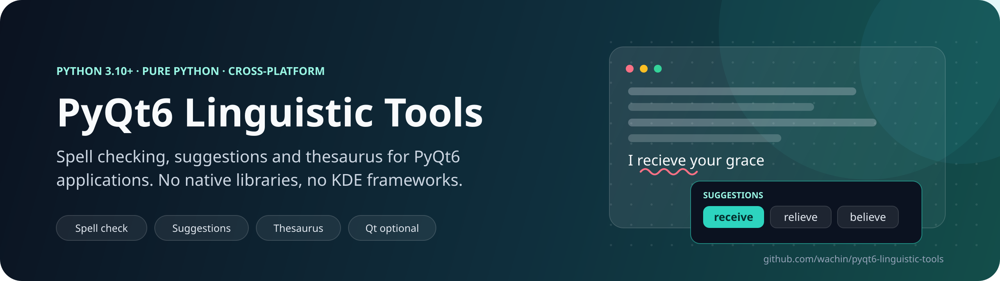
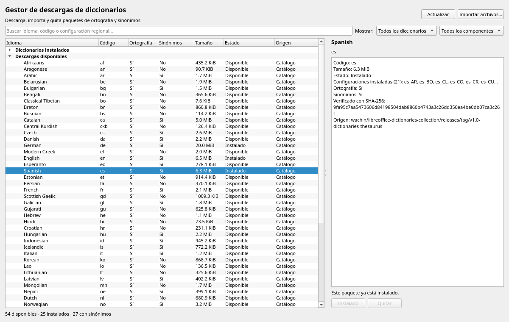
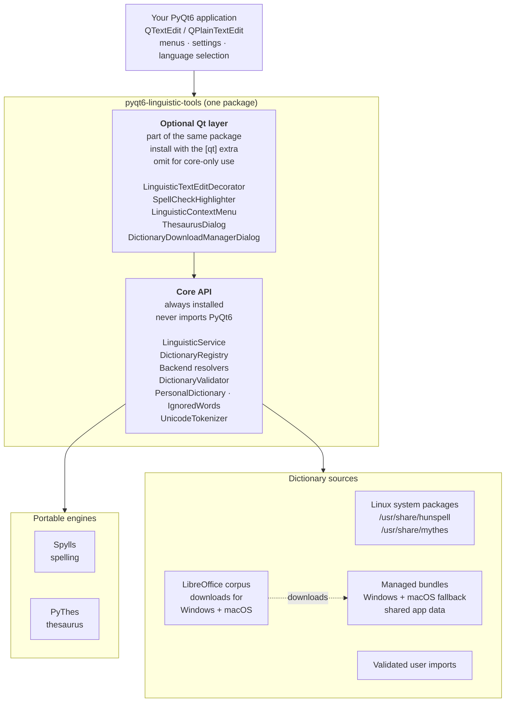

<p align="center">
  
</p>

<h1 align="center">PyQt6 Linguistic Tools</h1>

<p align="center">
  <em>One cross-platform linguistic API for Python and PyQt6 applications.</em>
</p>

<p align="center">
  <a href="https://github.com/wachin/pyqt6-linguistic-tools"></a>
  
  
  
  
  
  
  
  
</p>

<p align="center">
  
</p>

<p align="center"><em>Dictionary Download Manager in Spanish, ready to embed in ChordFlow,
ChordPages or any other PyQt6 application.</em></p>

PyQt6 Linguistic Tools gives Python and PyQt6 applications spell checking,
spelling suggestions, personal dictionaries, ignored words, and thesaurus
lookup behind one small API. It uses the portable
[Spylls](https://github.com/wachin/spylls) and
[PyThes](https://github.com/wachin/pythes) engines, so the same code runs on
Linux, Windows, and macOS without bundling Hunspell, MyThes, or KDE Frameworks.

- **No native dependencies.** The core is pure Python; PyQt6 is optional.
- **One API for every platform.** Linux system dictionaries, shared managed
  bundles, and validated user imports all go through the same service.
- **Built for real editors.** The optional Qt layer adds highlighting,
  asynchronous checking, context actions, a thesaurus dialog, and a Dictionary
  Download Manager without subclassing `QTextEdit` or `QPlainTextEdit`.
- **Safe by default.** Official dictionaries stay immutable; personal words and
  ignored words live in their own layers; invalid bundles are rejected before
  publication.

Native Hunspell and MyThes are outside the scope of this portable stage. They
may be added later as optional backends without changing the public API.

> **Status:** `1.0.0` is the first stable release. The fast suite, typing
> checks, platform smoke tests, and the manual-only CI matrix are documented in
> [`docs/testing.md`](docs/testing.md),
> [`docs/platform-testing.md`](docs/platform-testing.md), and
> [`docs/continuous-integration.md`](docs/continuous-integration.md).

## How it fits together



The outer box is the **toolkit package**. The **Qt layer is an optional part of
that same package**: install the `[qt]` extra when you want widgets, or omit it
and use only the core. The **core is always installed and never imports
PyQt6**; applications can use `LinguisticService`, the registry, validation,
and the engines without any Qt dependency.

On Linux, system Hunspell/MyThes packages are discovered automatically. On
Windows and macOS, the same experience comes from managed bundles downloaded
from the LibreOffice corpus (or from validated user imports); macOS does not
rely on Linux-style system packages.

## What you can build with it

- **Desktop editors** with live underlining, suggestions, personal
  dictionaries, ignore-once/document/session scopes, and a thesaurus.
- **A reusable Dictionary Download Manager** for Windows and macOS, where system
  Hunspell/MyThes files are not available, and for applications that ship
  their own dictionary bundles.
- **One integration for several applications**, such as ChordFlow and
  ChordPages, which share storage without duplicating linguistic code.
- **Corpus validation and compatibility reports** for dictionary collections,
  CI, and release checks.

## Key building blocks

The repository already ships the complete, network-free half of a dictionary
workflow:

| Module | What it gives you |
|---|---|
| [`src/pyqt6_linguistic_tools/catalog.py`](src/pyqt6_linguistic_tools/catalog.py) | The 57-entry `dictionaries.json` catalog shipped as package data (`load_bundled_dictionary_catalog()`), with SHA-256 checksums and spelling/thesaurus flags, plus strict network-free validation of any host-provided catalog. |
| [`src/pyqt6_linguistic_tools/qt/dictionary_manager.py`](src/pyqt6_linguistic_tools/qt/dictionary_manager.py) | Embeddable `DictionaryDownloadManagerWidget` and `DictionaryDownloadManagerDialog` with search, filters, spelling/thesaurus badges, a details panel, automatic verified downloads, manual import, and removal of application-owned bundles. The base classes retain the host-delegated `download_requested` mode. |
| [`src/pyqt6_linguistic_tools/providers.py`](src/pyqt6_linguistic_tools/providers.py) | `ManagedDictionaryProvider` and `UserDictionaryProvider` with shared cross-platform storage and atomic publication; Linux system dictionaries remain read-only. |
| [`src/pyqt6_linguistic_tools/validation.py`](src/pyqt6_linguistic_tools/validation.py) | `DictionaryValidator` deep checks for Hunspell/MyThes: encodings, counts, rules, byte offsets, representative words, and complete engine loading. |

## Quick start

```python
from pyqt6_linguistic_tools import LinguisticService

service = LinguisticService("es_EC")
service.check_word("canción")        # True when a Spanish dictionary is available
service.suggestions("marabillas")    # tuple of suggestions for the misspelling
service.synonyms("feliz")            # tuple of synonyms when a thesaurus is available
```

For Qt integration, install the optional extra and attach the decorator to an
existing editor:

```python
from pyqt6_linguistic_tools.qt import LinguisticTextEditDecorator

decorator = LinguisticTextEditDecorator(editor, service)
decorator.set_spellcheck_enabled(True)
```

## Managed dictionary downloads

The toolkit includes the complete, verified dictionary download workflow:

- **Bundled catalog.** `load_bundled_dictionary_catalog()` loads the 57-entry
  catalog shipped in `pyqt6_linguistic_tools/data/dictionaries.json`, with
  SHA-256 checksums and spelling/thesaurus flags;
  `load_dictionary_catalog(path)` validates a host-provided catalog instead.
- **Shared storage.** `ManagedDictionaryProvider` owns the cross-platform
  managed bundle directory; `UserDictionaryProvider` owns validated manual
  imports. ChordFlow and ChordPages share the `guitarchordstudio` namespace.
- **Download manager UI.** `DictionaryDownloadManagerWidget` (embeddable) and
  `DictionaryDownloadManagerDialog` provide search, filters,
  spelling/thesaurus badges, a details panel, and automatic verified downloads
  in a worker thread. The base `DictionaryManagerWidget`/`Dialog` keep the
  host-delegated `download_requested` mode for custom pipelines.
- **Verified installer.** `download_dictionary()` streams over HTTPS, checks
  the catalog size and SHA-256, rejects unsafe archive paths and links, deep
  validates every component, skips malformed regional variants, and publishes
  atomically through `ManagedDictionaryProvider`.
- **Validation.** Every manual import and every downloaded bundle passes
  `DictionaryValidator` before publication.

Windows and macOS use managed bundles when system dictionaries are not
installed or not discoverable. The download manager installs into the same
managed provider the application service discovers, so spelling and thesaurus
become available without restarting the app. Linux can additionally discover
system packages and can still use managed bundles to supplement or override
them. See [`docs/managed-dictionaries.md`](docs/managed-dictionaries.md) and
[`docs/dictionary-validation.md`](docs/dictionary-validation.md).

## Dictionary Download Manager

`DictionaryDownloadManagerWidget` is the embeddable, large-format manager:
search and state/component filters, spelling and thesaurus badges, installed and
available groups, a details panel, progress, and automatic verified
install/remove actions. `DictionaryDownloadManagerDialog` wraps the same widget
in a 1180×720 dialog. The widget performs the download in a worker thread and
publishes into the application's managed provider; no restart is required.

```python
from pyqt6_linguistic_tools import load_bundled_dictionary_catalog
from pyqt6_linguistic_tools.qt import (
    DictionaryDownloadManagerDialog,
    DictionaryDownloadManagerWidget,
)

catalog = load_bundled_dictionary_catalog()
manager = DictionaryDownloadManagerWidget(service, catalog=catalog)
layout.addWidget(manager)

dialog = DictionaryDownloadManagerDialog(service, catalog=catalog, parent=window)
dialog.exec()
```

For a host-owned download pipeline, use the base `DictionaryManagerWidget` or
`DictionaryManagerDialog`: they emit `download_requested` instead of downloading
and leave verification, extraction and publication to the host.

The dialog is a normal window: it has minimize, maximize and close controls,
can be resized from any edge or corner, and starts at a screen-aware size rather
than filling a 1366×768 display. It remembers its position and size between
sessions through `QSettings`. ChordFlow and ChordPages open it modelessly, so a
download can continue while the editor stays usable.

The toolkit ships its own Spanish and English Qt catalogs. Install one with
`install_toolkit_translations(app, "es")`; the host keeps its own translator and
can override individual messages. See
[`docs/translations.md`](docs/translations.md).
### ChordFlow and ChordPages

Both host applications expose the same manager:

- **ChordFlow:** *Herramientas → Gestor de descargas de diccionarios...*
- **ChordPages:** *Edit → Dictionary Download Manager...*

They share the `guitarchordstudio` managed namespace and one
`LinguisticService`. After a download, the service is refreshed and the toolkit
decorator on every editor can use the new spelling and thesaurus files without
a restart. This is the supported path for Windows and macOS, where no
Linux-style system Hunspell/MyThes packages exist.

## Documentation map

- [Architecture overview](docs/linguistics-architecture.md): layers, module map,
  and data-flow diagrams.
- [Backend API](docs/backend-api.md): contracts, lifecycle, errors, and
  thread-boundary guidance.
- [Dictionary registry](docs/dictionary-registry.md): providers, pairing, and
  source priority.
- [Managed dictionaries](docs/managed-dictionaries.md): storage, imports,
  catalog, and the Dictionary Download Manager.
- [Dictionary validation](docs/dictionary-validation.md): Hunspell/MyThes
  checks and import boundaries.
- [Qt architecture](docs/qt-architecture.md): decorator, highlighter, context
  menu, dialogs, and settings.
- [Translations](docs/translations.md): bundled `.ts`/`.qm` catalogs, the
  installer helper, and host override rules.
- [Testing](docs/testing.md) and
  [continuous integration](docs/continuous-integration.md): suites, corpus
  runs, and manual workflows.

## Design references

The Hunspell, MyThes, and Sonnet sources that informed this architecture were
studied from temporary submodules and have been removed from the repository.
The lessons, the last pinned revisions, and how to consult them outside the
repository are recorded in
[`docs/hunspell-sonnet-mythes-study.md`](docs/hunspell-sonnet-mythes-study.md).

---

## Portable backend API

`SpyllsBackend` and `PyThesBackend` implement stable engine-neutral contracts.
Both load their configured dictionary on first use and can be explicitly
unloaded. `BackendCache` provides an LRU bound for applications that switch
between languages. Engine exceptions and result types never leak through the
public API.

See [`docs/backend-api.md`](docs/backend-api.md) for usage, lifecycle, error,
metadata, and thread-boundary guidance.

`SpellBackendResolver` and `ThesaurusBackendResolver` select Spylls and PyThes
by default on every platform. Optional future engines can register behind the
same contracts. Explicit requests and fallbacks return structured diagnostics
and always preserve the requested document locale.

`DictionaryRegistry` combines prioritized dictionary providers, pairs
Hunspell and MyThes files, supports regional locales, and reports whether a
language has spelling, a thesaurus, or both. See
[`docs/dictionary-registry.md`](docs/dictionary-registry.md).

On Linux, `LinuxSystemDictionaryProvider` automatically discovers supported
Hunspell and MyThes files installed in the standard `/usr/share` locations.
They remain read-only and are consumed by the portable Spylls/PyThes engines;
loading `libhunspell` or `libmythes` is not required.

`ManagedDictionaryProvider` and `UserDictionaryProvider` use shared
cross-platform application-data locations and support safe manual imports.
The validated `dictionaries.json` catalog and the
`DictionaryDownloadManagerDialog` provide checksum-gated downloads. The
downloader verifies the archive, extracts it safely, validates every component,
and publishes into the managed namespace; the base manager classes keep the
host-delegated `download_requested` mode. See
[Managed dictionary downloads](#managed-dictionary-downloads) and
[`docs/managed-dictionaries.md`](docs/managed-dictionaries.md).

`DictionaryValidator` produces structured `PASS`, `WARNING`, and `FAIL`
reports by checking encodings, counts, rules, offsets, representative entries,
and complete Spylls/PyThes loading. Manual imports must pass this validation
before atomic publication. See
[`docs/dictionary-validation.md`](docs/dictionary-validation.md).

`PersonalDictionary` persists NFC-normalized Unicode words in separate UTF-8
files per locale. Atomic replacement and portable per-locale locks allow
ChordFlow and ChordPages to share storage without modifying source
dictionaries. See [`docs/personal-dictionary.md`](docs/personal-dictionary.md).

`IgnoredWords` keeps ignore-once, document-wide, and session-wide spelling
exceptions in memory, separated by locale and entirely independent of the
persistent personal dictionary. See [`docs/ignored-words.md`](docs/ignored-words.md).

`PersonalDictionaryBackupManager` provides validated previews, atomic UTF-8
exports, and transactional merge or replace restoration across locales. Its
portable backups contain only personal words and never alter official source
dictionaries. See [`docs/personal-backups.md`](docs/personal-backups.md).

`UnicodeTokenizer` recognizes words and combining marks across scripts,
preserves linguistic apostrophes and hyphens, excludes configurable technical
regions, and returns exact Python plus Qt-compatible UTF-16 positions. See
[`docs/unicode-tokenizer.md`](docs/unicode-tokenizer.md).

`LinguisticService` unifies registry discovery, lazy spelling and thesaurus
backends, personal dictionaries, ignored-word scopes, capability reporting,
language switching, and bounded diagnostics behind the application-facing API.
See [`docs/linguistic-service.md`](docs/linguistic-service.md).

Malformed or missing resources are isolated by exact locale and component.
Healthy languages remain available, repeated failures are suppressed, and
structured diagnostics can be bridged to Python logging. See
[`docs/error-handling.md`](docs/error-handling.md).

Fast, Qt-offscreen, curated corpus, and full-corpus test workflows are kept
separate and mapped to their contracts in [`docs/testing.md`](docs/testing.md).
Current operating-system smoke tests and their explicit skip rules are
documented in [`docs/platform-testing.md`](docs/platform-testing.md).
The manually dispatched GitHub Actions fast matrix and corpus workflows are
documented in [`docs/continuous-integration.md`](docs/continuous-integration.md).

Bounded LRU caches reuse spelling, suggestion, and thesaurus results while
registry and personal-dictionary revisions provide automatic invalidation.
Cache statistics remain available for tuning without exposing engine objects.
See [`docs/result-caching.md`](docs/result-caching.md).

The optional `pyqt6_linguistic_tools.qt` package establishes a lazy,
one-directional integration boundary without making PyQt6 a core dependency.
Its editor decorators keep independent per-document languages, optionally
persisted through a host-provided `QSettings`, while sharing one linguistic
service. The language menu distinguishes regional variants and reports
spelling and thesaurus availability. Its Dictionary Download Manager safely
downloads, inspects, imports, and removes only application-owned bundles while
leaving system dictionaries immutable. Install the `[qt]` extra for widgets.
See
[`docs/qt-architecture.md`](docs/qt-architecture.md).

## Installation, development, and direct source use

`pip` is an installation tool; it is not a runtime requirement. Running an
application with `python -m application_name` does not inherently require
`pip` or a virtual environment. It requires the application package, this
toolkit, and the necessary runtime dependencies to be discoverable on Python's
import path.

There are three supported ways for a project to consume this toolkit:

1. Install it in a project virtual environment. This is the recommended
   development workflow.
2. Vendor it as source, as GuitarChordStudio does with its Git submodule, and
   arrange the source directories on the application's import path.
3. Include or install it through an operating-system package, AppImage, or
   another application packaging system. In this case the packaging system,
   not the end user, supplies the import paths and dependencies.

### Why a virtual environment is recommended

Debian, Ubuntu, and some derived or other Linux distributions mark their system
Python installation as externally managed. Under the PyPA externally managed
environments specification, `pip` should refuse to add, upgrade, or remove
packages in that interpreter's global environment and direct the user to a
virtual environment instead. This protects packages owned by the operating
system.

This restriction is distribution-dependent; it does not mean that `pip` cannot
be used on Linux. Use `pip` inside a virtual environment. Do not use
`sudo pip`, and do not recommend bypassing the protection with
`--break-system-packages` for normal development.

If the standard `venv` module is unavailable on a Debian-family system, install
the operating system package first:

```bash
sudo apt install python3-venv
```

Then create an isolated environment from the repository:

```bash
git submodule update --init --recursive
python3 -m venv .venv
source .venv/bin/activate
python -m pip install -e '.[test,qt,typing]'
python -m pytest
python -m mypy
```

The environment remains active only in the current shell. Leave it with:

```bash
deactivate
```

On Windows, the equivalent setup is:

```powershell
git submodule update --init --recursive
py -m venv .venv
.venv\Scripts\Activate.ps1
python -m pip install -e ".[test,qt,typing]"
python -m pytest
python -m mypy
```

The `[test]` extra installs test dependencies, and `[typing]` installs mypy for
contributors. The `[qt]` extra requests `PyQt6>=6.6` for projects that do not
already provide PyQt6. GuitarChordStudio
does not need to install PyQt6 twice when its own development or packaging
environment already supplies it.

### Using the source checkout without pip

Developers may use the toolkit without installing it through `pip`. This
repository uses a `src` layout and vendors Spylls and PyThes in separate
directories, so all three source roots must be discoverable.

For a one-off Unix shell session from the GuitarChordStudio repository root:

```bash
export PYTHONPATH="$PWD/libs/pyqt6-linguistic-tools/src:$PWD/libs/pyqt6-linguistic-tools/libs/spylls:$PWD/libs/pyqt6-linguistic-tools/libs/pythes${PYTHONPATH:+:$PYTHONPATH}"
python -m application_name
```

Replace `application_name` with the actual module used by the host program.
This command is an example of source-path configuration, not an additional
installation method.

A host application may instead configure the same paths in its development
launcher or bootstrap code before importing `pyqt6_linguistic_tools`. That is
often more convenient for a Git-submodule workflow because contributors can
run the program directly without modifying the system Python installation.
Whichever mechanism is used, PyQt6 and any other non-vendored dependencies must
still be available from the interpreter chosen to run the application.

For released `.deb` packages or AppImages, the packager should install or
bundle the toolkit, PyQt6, Spylls, PyThes, and the selected dictionaries in
locations already known to the packaged interpreter. End users should not need
to create a virtual environment or run `pip` merely to launch the packaged
application.

The maintained Spylls and PyThes source packages are included in toolkit
distributions and in this repository. Applications do not install those engine
forks separately.

Official references:

- [Python `venv` documentation](https://docs.python.org/3/library/venv.html)
- [PyPA guide to installing with `pip` and `venv`](https://packaging.python.org/en/latest/guides/installing-using-pip-and-virtual-environments/)
- [PyPA externally managed environments specification](https://packaging.python.org/en/latest/specifications/externally-managed-environments/)

## Running the test suite

```bash
python -m pytest
```

The fast tests do not require external dictionary downloads. The compatibility
suite uses an explicitly configured LibreOffice dictionary collection:

```bash
LIBREOFFICE_DICTIONARIES_PATH=/path/to/dicts \
  python -m pytest -m 'corpus and not full_corpus'
```

The corpus can also be selected with a command-line option:

```bash
python -m pytest -m 'corpus and not full_corpus' \
  --dictionary-corpus=/path/to/dicts
```

The full thesaurus pass is reserved for explicit manual execution:

```bash
python -m pytest -m full_corpus --dictionary-corpus=/path/to/dicts
```

Linux system-resource smoke tests can be selected independently. They skip
with a visible reason when the required packages or `es_EC` data are absent:

```bash
python -m pytest -m platform
```

The corpus path is never embedded in the package. See
[`docs/engine-baseline.md`](docs/engine-baseline.md) for the verified initial
engine status.

## Compatibility report

The portable engines include a machine-readable dictionary compatibility report
by locale and component:

```bash
python -m pyqt6_linguistic_tools.compatibility_report \
  /path/to/dicts \
  compatibility-report.json
```

The report is versioned UTF-8 JSON with deterministic ordering, containing
per-locale spelling and thesaurus validation results, classifications
(`ready`, `limited`, `unsupported`), source paths relative to the corpus root,
encodings, and reproducibility metadata (toolkit and engine versions,
Python/platform, generation time).

## Examples

The `examples/` directory contains standalone PyQt6 applications that
demonstrate the toolkit's features. Each example can be run directly:

```bash
# QTextEdit with spell checking
python examples/basic_qtextedit.py

# QPlainTextEdit with spell checking
python examples/basic_qplaintextedit.py

# Spell checking, suggestions, and personal dictionary
python examples/spellcheck_demo.py

# Thesaurus browser
python examples/thesaurus_demo.py

# Dictionary Download Manager dialog
python examples/dictionary_manager_demo.py

# Full demo combining all features
python examples/full_demo.py
```

Set `LIBREOFFICE_DICTIONARIES_PATH` to use a LibreOffice dictionary corpus for
additional languages. On Linux, system-installed hunspell and mythes
dictionaries are discovered automatically.

The full demo (`full_demo.py`) shows how a PyQt6 application can integrate
the complete toolkit with minimal code — editor, spell checking, thesaurus,
dictionary management, and language switching.

## Performance benchmark

The portable engines include a reproducible, subprocess-isolated benchmark for
load time, lookup and suggestion latency, thesaurus caching, and peak memory:

```bash
python -m pyqt6_linguistic_tools.performance \
  --corpus=/path/to/dicts \
  --output=performance-report.json
```

The default small, medium, and very-large matrix and its initial diagnostic
budgets are documented in
[`docs/performance-budgets.md`](docs/performance-budgets.md). Performance
budgets are review thresholds rather than machine-dependent pytest failures.

## Contributing

See [`CONTRIBUTING.md`](CONTRIBUTING.md) for the engine-fork policy, the test
matrix, and the manual-only CI rules. The normal local gate is:

```bash
QT_QPA_PLATFORM=offscreen python3 -m pytest -c pyproject.toml -q \
  -m 'not corpus and not platform'
python3 -m mypy
git diff --check
```

The toolkit is designed to be reused as a Python package, a Git submodule, or
an OS package/AppImage component. See [`docs/reuse.md`](docs/reuse.md) and
[`docs/release-checklist.md`](docs/release-checklist.md).

The README banner is generated from `docs/assets/banner.svg`. Edit the SVG and
run `python3 docs/assets/render-banner.py` to refresh `banner.png`; the script
tries PyQt6/QtSvg, cairosvg, rsvg-convert, and Inkscape in that order.

The vendored Spylls and PyThes forks keep their own licenses (MPL-2.0 and MIT);
see the `license-files` entry in [`pyproject.toml`](pyproject.toml).
