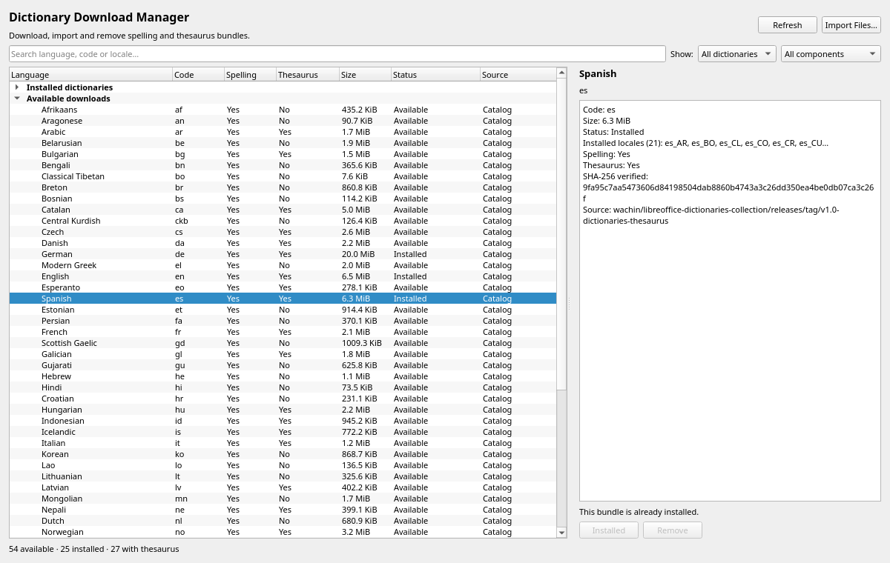

# Managed and user dictionaries

The toolkit provides cross-platform storage and discovery without requiring
system-wide Hunspell, a DLL, or a native MyThes library. ChordFlow and
ChordPages can share one data root by using the same namespace.

## Data locations

```python
from pyqt6_linguistic_tools import dictionary_storage_paths

paths = dictionary_storage_paths("GuitarChordStudio")
print(paths.managed)
print(paths.user)
print(paths.personal)
```

When PyQt6 is available, the base comes from
`QStandardPaths.GenericDataLocation`. The toolkit does not change the global
`QCoreApplication` organization or application name. Without Qt it uses the
standard platform convention:

- Windows: `%APPDATA%`;
- macOS: `~/Library/Application Support`;
- Linux and other Unix systems: `$XDG_DATA_HOME` or `~/.local/share`.

Constructing a provider never creates a directory. A missing first-run path is
an empty source, not an error. `ensure_directory()` performs creation only
when explicitly requested by the host application.

## Providers

```python
from pyqt6_linguistic_tools import (
    DictionaryRegistry,
    ManagedDictionaryProvider,
    UserDictionaryProvider,
)

managed = ManagedDictionaryProvider(namespace="GuitarChordStudio")
user = UserDictionaryProvider(namespace="GuitarChordStudio")
registry = DictionaryRegistry((managed, user))
```

Managed dictionaries use priority 200 and user-imported dictionaries use
priority 300. Therefore a user bundle may override a managed component while
retaining any non-conflicting managed thesaurus or spelling component.

These providers work identically on Linux, Windows, and macOS. They neither
inspect nor modify Linux system dictionary directories. The separate
`LinuxSystemDictionaryProvider` discovers those read-only files and passes
them to Spylls/PyThes; this is independent of the optional, post-1.0 native
backend stage.

## Manual import

`UserDictionaryProvider.import_files()` accepts already unpacked files:

```python
destination = user.import_files(
    ["es_EC.aff", "es_EC.dic", "th_es_v2.dat", "th_es_v2.idx"],
    bundle_name="spanish-ecuador",
)
```

The import validates complete Hunspell pairs and MyThes data, rejects unknown
files and duplicate names, stages copies inside the destination filesystem,
loads every staged component through Spylls/PyThes, and publishes the complete
directory with one atomic rename. A failed deep validation removes staging and
attaches its structured report to `DictionaryImportError`. Existing bundles
are never overwritten. Archive extraction requires a separate, explicit
policy and is not performed by this API. See
[`dictionary-validation.md`](dictionary-validation.md).

Application-owned providers expose `remove_bundle(name)` for one direct bundle
directory. The name cannot contain path separators, symbolic links are
refused, and the operation is unavailable on `DirectoryDictionaryProvider`.
Consequently a generic provider used for Linux system dictionaries has no
removal API. The Qt Dictionary Download Manager applies the same ownership checks and
asks for confirmation before removal.

## dictionaries.json catalog

The toolkit ships a curated 57-entry catalog at
`pyqt6_linguistic_tools/data/dictionaries.json`, so applications get a usable
download list without shipping their own copy:

```python
from pyqt6_linguistic_tools import load_bundled_dictionary_catalog

catalog = load_bundled_dictionary_catalog()
spanish = catalog.get("es")
```

`load_dictionary_catalog(path)` remains available for a host-provided or newly
generated catalog. The loader validates its schema, safe unique codes, names,
HTTPS URLs, sizes, and optional SHA-256 fields. It treats hyphen and underscore
code forms as equivalent for lookup while preserving the published value.

The bundled catalog is generated from the release assets with
`tools/fetch-dict-list.py --tag <TAG>`. Pass `--dicts-dir` pointing at the local
LibreOffice collection to record the `spelling` and `thesaurus` flags by
checking each bundle's `.aff`/`.dic` and `.dat`/`.idx` files. The generator also
records the SHA-256 digest that GitHub exposes for each asset, so
`catalog.supports_verified_downloads` is true for the bundled catalog.

The toolkit performs verified downloads through
`download_dictionary(entry, provider)`. It streams the HTTPS asset, checks the
catalog size and SHA-256, rejects absolute paths, `..`, links and unsupported
archive entries, deep validates each component, skips malformed regional
variants, and atomically publishes the valid bundle through
`ManagedDictionaryProvider`. Use `install_dictionary_archive()` when the host
already downloaded the asset.

## Qt Dictionary Download Manager

`DictionaryDownloadManagerWidget` is the embeddable, large-format manager:
search, state and component filters, spelling/thesaurus badges, installed and
available groups, a details panel with install/remove actions, and automatic
verified downloads in a worker thread. `DictionaryDownloadManagerDialog` wraps
the same widget in a 1180×720 dialog. Both display effective languages and any
application bundle hidden by a higher-priority source, with locale, component
availability, source ownership, and the exact files. Manual imports also run in
a Qt thread pool so loading a large Spylls or PyThes dictionary does not block
the GUI.



```python
from pyqt6_linguistic_tools import load_bundled_dictionary_catalog
from pyqt6_linguistic_tools.qt import (
    DictionaryDownloadManagerDialog,
    DictionaryDownloadManagerWidget,
)

catalog = load_bundled_dictionary_catalog()

# Embed in a settings page or tab; downloads install automatically.
widget = DictionaryDownloadManagerWidget(service, catalog=catalog)
layout.addWidget(widget)

# Or open the large dialog.
manager = DictionaryDownloadManagerDialog(
    service, catalog=catalog, parent=window
)
manager.dictionaries_changed.connect(refresh_language_selectors)
manager.show()
```

Entries without SHA-256 remain visibly unverified and disabled. Downloads
install into the managed provider namespace used by the application service, so
the next check sees the new spelling and thesaurus files without a restart.
For a custom pipeline, use the base `DictionaryManagerWidget` or
`DictionaryManagerDialog`: they do not perform network access and instead emit
`download_requested` for the host to verify, extract and publish.
